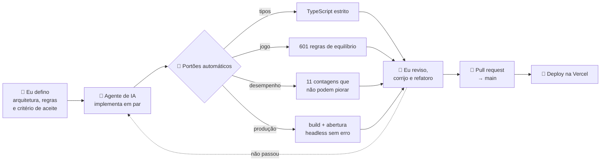
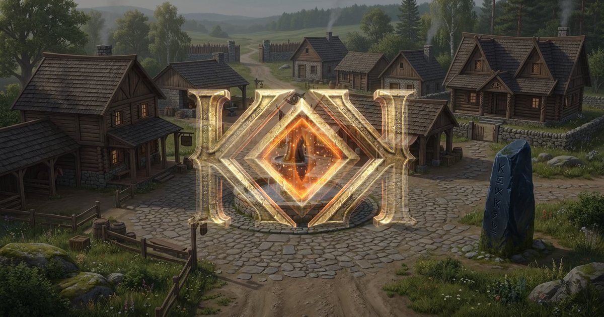
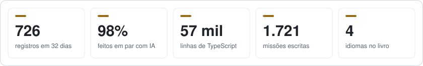
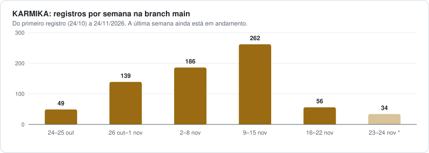
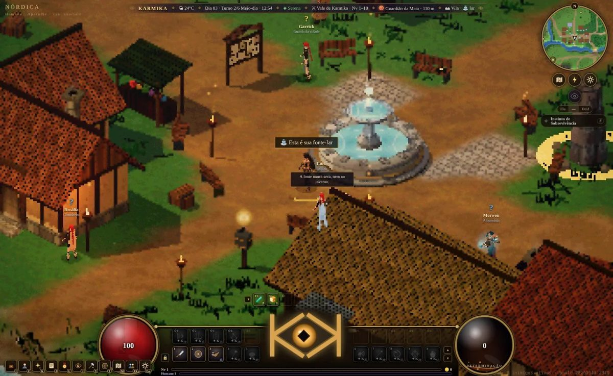
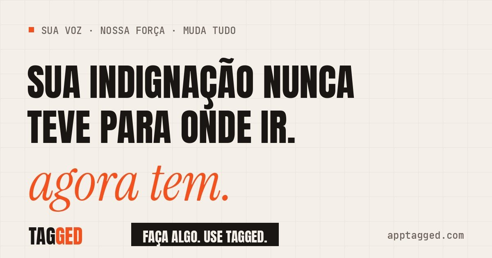
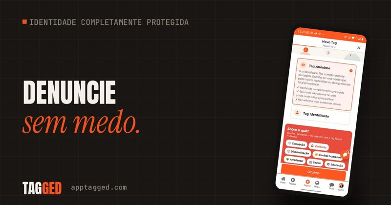
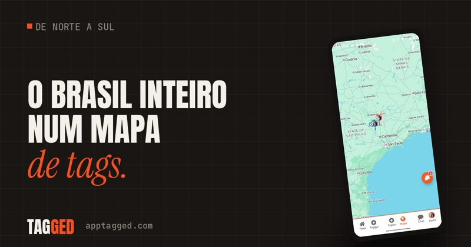
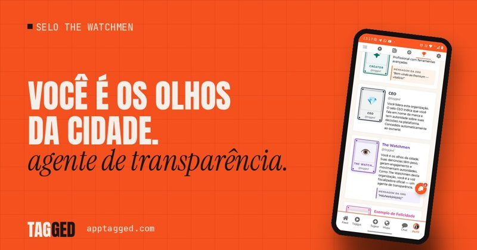

# 👋 Olá! Eu sou Erling Sriubas

  

  
  
  
  
  
  

## 🚀 Sobre mim

Sou **Senior Frontend Developer**, especialista em **arquitetura frontend** e **Design Systems escaláveis**, e construo **produtos digitais do zero**: da ideia à produção, com o código no padrão que eu exijo.

Hoje eu trabalho com **IA como parte do time**. Uso agentes de código como par de programação no dia a dia, e o papel de quem decide continua sendo meu: eu defino a arquitetura, reviso cada mudança, corrijo, refatoro e só aceito o que passa nos portões de qualidade. O resultado é velocidade de equipe com o critério de um sênior.

São **mais de 10 anos como desenvolvedor**, e antes deles vieram **mais de 10 anos como cozinheiro**. Trouxe de lá a precisão, a gestão sob pressão e o *mise en place*: disciplina, organização e zero desperdício, que é exatamente como trato um repositório.

---

## 💼 Experiência

| | |
|---|---|
| 🎮 **KARMIKA** · criador *(atual)* | MMORPG em Three.js/TypeScript desenvolvido com agentes de IA: arquitetura, jogo, landing page e publicação |
| 🌍 **Tagged** · Founder & CEO | Plataforma cívica: produto, arquitetura frontend e mobile |
| 🏥 **Datum → Unimed** · React especialista | Plataforma +Unimed |
| 🔧 **Bosch / BISB** · Senior Frontend Developer | Sistemas internos enterprise e arquitetura de Design System |
| ⚡ **Delta Energia** · Dev líder web/mobile | Plataforma de gestão de energia com UX complexa e Design System |
| 🎨 **Portobello** · Tech Lead | Design System completo do zero |
| 🏢 **Gerdau** · Design System Squad | Arquitetura de componentes enterprise |
| 🚗 **99** | Sistemas de atendimento e experiência do usuário |

---

## 🛠️ Stack

**Core**

**3D, jogo & desktop**

**IA no fluxo de trabalho**

**Estado, dados & validação**

**UI & styling**

**Qualidade, build & deploy**

---

## 🎨 Design Systems

Crio **Design Systems do zero**, transformando design em bibliotecas de componentes escaláveis que aceleram novos produtos, mantêm a identidade visual consistente, facilitam a manutenção e melhoram a colaboração entre times. Frontend independente, mas sempre alinhado: sem esperar o backend para entregar valor.

---

## 🤖 Como eu construo com IA

Não é "pedir código para a IA". É um processo de engenharia em que o agente escreve e testa, e eu dirijo, reviso e decido. No KARMIKA, **98% dos registros** foram feitos assim:

- **Arquitetura antes do prompt:** pastas por domínio, um arquivo por coisa, lógica fora da camada de visão, SOLID. A IA trabalha dentro das regras do projeto, não o contrário.
- **Desempenho como critério de aceite:** nenhum registro entra se piorar as contagens medidas (luzes, desenhos, triângulos). O jogo precisa rodar em PC modesto.
- **Teste visual automatizado:** navegador headless (Playwright) abre o jogo, entra nas cenas e tira fotos para conferir o que mudou.
- **Rastreabilidade:** todo registro diz o que foi conferido e o que não foi. Nada é dado como pronto sem prova.

---

## 🎮 KARMIKA — o MMORPG onde cada escolha volta para você

  

 

**[KARMIKA](https://karmikaonline.com)** é o jogo que estou criando: um MMORPG isométrico em que o **karma** é a regra do mundo. Todo mundo nasce humano, anão ou elfo, e são as escolhas que transformam o personagem em paladino, vampiro, lobisomem, mago, bruxo, guerreiro de Odin ou tecnocrata. Morrer não é o fim: você renasce carregando o que fez na vida anterior.

- 🌐 **Landing page:** [karmikaonline.com](https://karmikaonline.com), com o livro do mundo em português, inglês, espanhol e letão
- ▶️ **Jogue no navegador:** [jogar.karmikaonline.com](https://jogar.karmikaonline.com) (até o nível 10; o jogo completo vem por instalador)
- 📦 **Código:** [Erlingsjunior/karmika](https://github.com/Erlingsjunior/karmika)

  <picture>
    <source media="(prefers-color-scheme: dark)" srcset="assets/karmika-numeros-escuro.svg">
    
  </picture>

 

  <picture>
    <source media="(prefers-color-scheme: dark)" srcset="assets/karmika-semanas-escuro.svg">
    
  </picture>

 

**Por dentro:** monorepo com `pnpm`, cliente em **Three.js + TypeScript + Vite**, partículas com `three.quarks`, colisão com `three-mesh-bvh`, navegação de NPCs com `Yuka`, versão desktop em **Electron**, multijogador por **WebSocket**, landing e jogo web publicados na **Vercel**.

  

---

## 🌍 Tagged — a primeira RealTech do mundo

  

 

Sou fundador e CEO da **[Tagged](https://www.apptagged.com)**, uma plataforma que transforma engajamento digital em **ação legal real**, convertendo o "marcar" (TAG) em assinaturas digitais com força jurídica.

**Cada post tem PESO, cada TAG tem PROPÓSITO.** Denúncia geolocalizada no mapa, petição coletiva, jornalismo verificado por gente real, organizações e cidadãos agindo lado a lado. Tagged não é mais uma rede social: é infraestrutura cívica.

  
  
  

 

- 🌐 **Site:** [apptagged.com](https://www.apptagged.com)
- 📱 **App:** mapa geolocalizado de tags, denúncia com identidade protegida, selos, conquistas e IA a serviço da causa

---

## 📚 Autor

Escrevi **"O Esquecido — Entre a Luz e as Sombras"**, uma saga de fantasia que mistura mitologia grega, misticismo cristão e folclore brasileiro. Cinco anos transformando narrativa em mundo. Hoje escrevo também o livro do mundo do KARMIKA, publicado no [site](https://karmikaonline.com) em quatro idiomas.

## 🌐 Idiomas

🇧🇷 Português (nativo) · 🇺🇸 Inglês (profissional) · 🇪🇸 Espanhol (intermediário)

## 💡 Mentalidade

> "Não construo apenas aplicações. Construo **experiências** que transformam a forma como as pessoas interagem com a tecnologia e, no fim, mudam o mundo."

## 🤝 Vamos conversar?

- 💬 Frontend, arquitetura e Design Systems
- 🤖 Desenvolvimento de produto com agentes de IA, com qualidade de produção
- 🎮 KARMIKA, Three.js e jogos no navegador
- 🚀 Tagged e tecnologia com impacto cívico

---

  **[🎮 Conheça o KARMIKA](https://karmikaonline.com)** · **[🌍 Use a Tagged](https://www.apptagged.com)**

  ⭐ Se curtiu meu trabalho, deixa uma estrela nos projetos!

  Gráficos gerados por <code>scripts/graficos.py</code> com números conferidos no repositório do KARMIKA em 24/11/2026.

